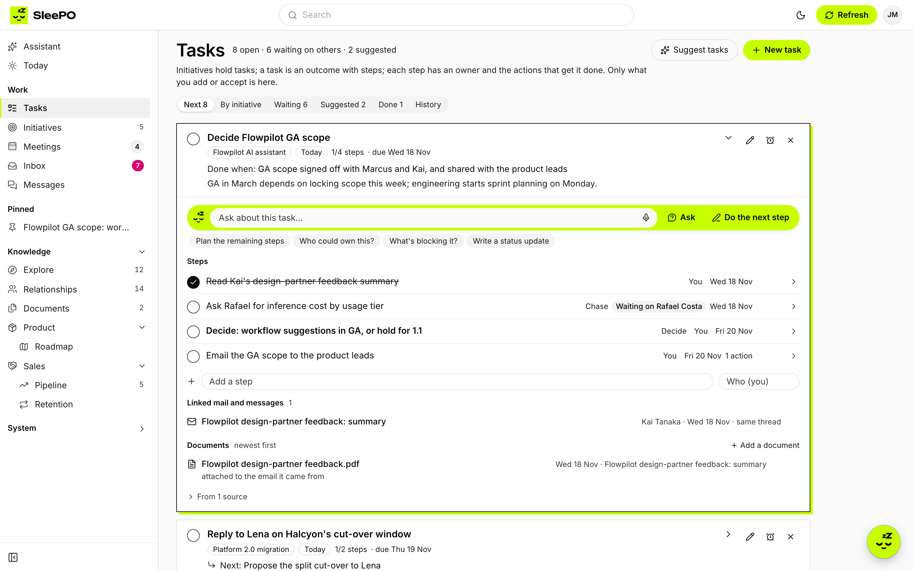
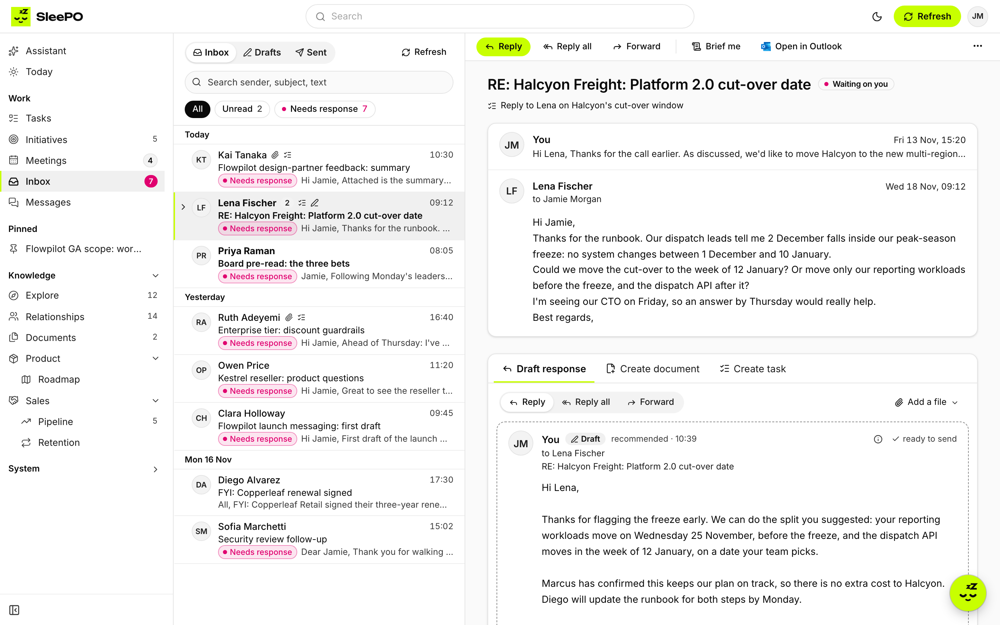
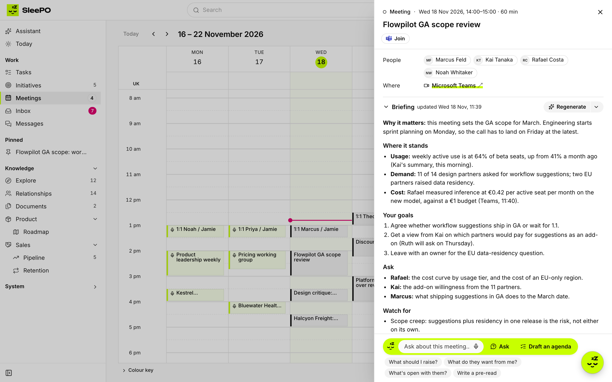
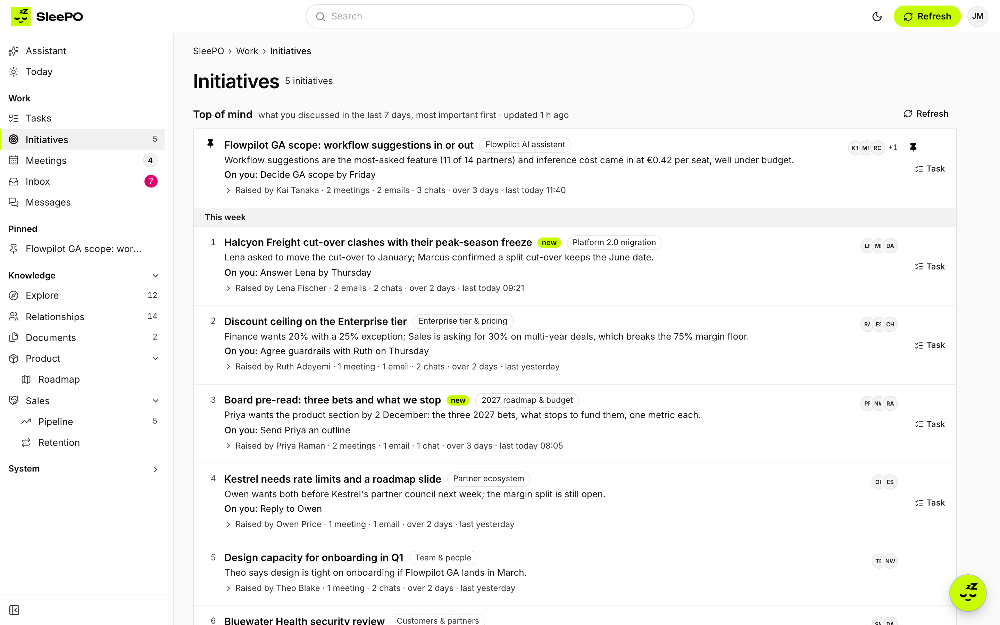
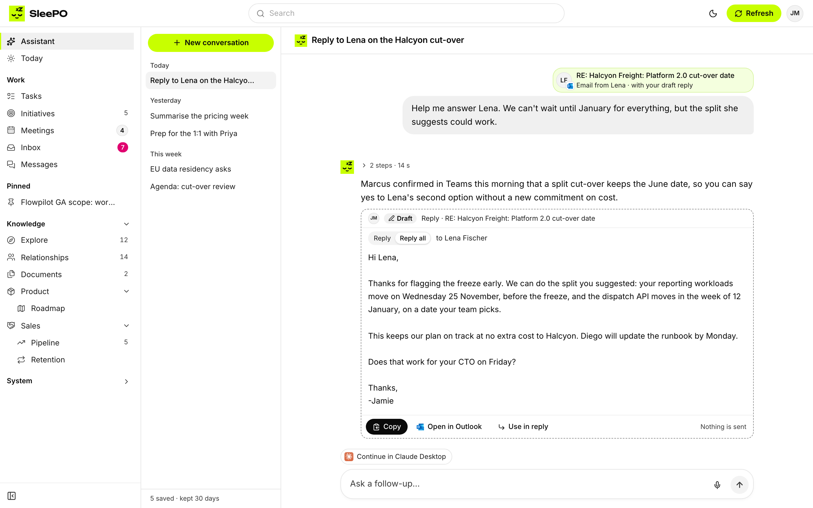
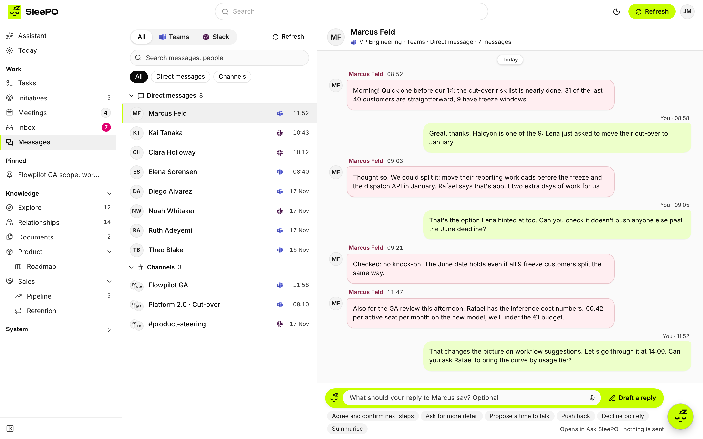

<p align="center">
  
</p>

<h1 align="center">SleePO</h1>

<p align="center"><b>A chief of staff that works while you sleep.</b><br>
It reads your mail, calendar, meeting notes, Teams and Slack, and every morning hands you one ranked list of what matters,
with the replies already drafted and every meeting already prepared.</p>

<p align="center">
  Runs on your Mac&nbsp;·&nbsp;Reads, never sends&nbsp;·&nbsp;Powered by Claude
</p>

<p align="center">
  Recommended to run with&nbsp;
  <a href="https://granola.ai">&nbsp;Granola</a>
  &nbsp;and&nbsp;
  <a href="https://github.com/altic-dev/FluidVoice">&nbsp;FluidVoice</a>
  &nbsp;(<a href="#recommended-granola-and-fluidvoice">why</a>)
</p>

<p align="center">
  
</p>

---

## Why SleePO

Leaders don't run out of ideas. They run out of attention. The promise made at the end of a call, the email that needed an
answer by Friday, the deck someone asked you to review in a Teams chat: each one is small, and together they decide whether
your week moves your big bets forward or just keeps you busy.

SleePO reads everything that comes in, works out what is actually on you, and does the first draft of the work, so you
spend your time deciding instead of searching.

- **Nothing slips.** Promises, replies you owe and things you're waiting on are found in mail, meetings and chat and
  proposed as tasks. You accept, edit or dismiss them.
- **Nothing goes out without you.** SleePO drafts; you send. It never sends an email or a message, and it only reads from
  your accounts.
- **Your data stays yours.** It runs on your own Mac, keeps its database there, and uses Claude through your own Claude
  account.

## What it does

### Your day on one page
The first page, **Actions**, splits your day in two. On one side, what people are waiting on you for: the emails that need
a response (the CEO and people outside your company first), the Teams and Slack messages you owe, and the follow-ups from
your calls, each linked to the moment it was said. On the other, what SleePO recommends you start: the emails it has
already written for you, the promises you made and haven't kept yet, and the next steps on your bets. One click opens the
reply, the draft, or a chat with SleePO about it.

### One list that runs your week
SleePO turns what it reads into tasks filed under your strategic bets (your "initiatives"), each with steps, owners and
dates. The **Next** view ranks the next step on every task by what matters most to you: the bet's weight, who is involved,
whether someone is blocked on you, and the date. Suggestions wait for your OK; nothing lands on your list by itself.

### Replies written before you open the email
Every email that needs a response gets a recommended reply, written in your voice (learned from your own sent mail).
Change it with one line ("shorter", "push back on the date", "warmer"), rewrite just the sentence you select, or answer a
couple of quick questions to fill in the blanks. When it's right, open it in Outlook and press send yourself.

<p align="center"></p>

### Walk into every meeting ready
Before each meeting SleePO writes a brief shaped to the meeting: a one-to-one with someone on your team, a catch-up with
your manager, a customer call or a leadership forum each get the points that matter for that kind of meeting. After the
call it proposes the follow-ups, each one linked to the moment in the transcript where it was said (the transcript comes
from [Granola](#recommended-granola-and-fluidvoice)).

<p align="center"></p>

### See what's top of mind
The **Initiatives** page opens on the topics that came up in the last seven days across calls, mail and chat, filed
under your bets: who raised each topic, where it stands and what is on you. Pin the ones you're working on, open a topic to see
the latest files and messages on it, and turn any of them into a task in one click.

<p align="center"></p>

### Ask about anything you're looking at
Press <kbd>⌘</kbd> <kbd>J</kbd> on an email, a person, a meeting or a task and ask. **Ask SleePO** already knows what's on
screen, searches everything it holds, and answers with sources. It writes emails as cards you edit in place, drafts
documents, and lays out options when you have a decision to make.

<p align="center"></p>

### Teams and Slack in one place
Your direct messages, group chats and channels from both apps in one list, with one conversation per person however
many apps you use with them. Say what your reply should say, or pick "Agree and confirm next steps", and SleePO drafts it
in your voice. When someone shares a deck for review, SleePO checks its claims against what it knows and suggests edits
you keep or drop.

<p align="center"></p>

### And more
- **A live call companion.** During a recorded call, see the brief next to the transcript as it's spoken and ask "what did
  they just agree?" (needs [Granola](https://granola.ai)).
- **Talk instead of typing.** Every box where you tell SleePO what you want has a microphone. Click it, say what you
  want, and [FluidVoice](https://github.com/altic-dev/FluidVoice) types it in.
- **People first.** Every name opens that person's page: their role, your next meeting, your latest exchanges and what you
  owe each other.
- **It remembers what you tell it.** Say "never copy finance on early pricing drafts" once and SleePO keeps to it. It learns
  only from your own words, never from other people's mail, and you can edit or delete anything it remembers.
- **It works on its own schedule.** A full refresh every weekday morning before you start, and a quick sync every 30 minutes
  through the working day.

## Recommended: Granola and FluidVoice

SleePO works on its own, and we recommend running it with two other Mac apps: Granola, so SleePO knows what was said in
your meetings, and FluidVoice, so you can tell SleePO what you want by speaking instead of typing.

<table>
<tr>
<td width="96" align="center" valign="top">
<a href="https://granola.ai"></a>
</td>
<td valign="top">
<b><a href="https://granola.ai">Granola</a></b>: meeting notes and transcripts<br><br>
Granola takes notes on your calls and keeps the transcript. SleePO reads them to know what was said, by whom:
<ul>
<li>the follow-ups after each call, each linked to the moment it was said</li>
<li>the promises made in meetings, which become proposed tasks</li>
<li>the <b>Top of mind</b> topics, and "last time you met" on each person's page</li>
<li>briefs that pick up where the last meeting left off</li>
<li>the live call companion, and the slides that were on screen</li>
</ul>
<b>Without it,</b> SleePO still sees your meetings in your calendar, but not what was said in them.
</td>
</tr>
<tr>
<td width="96" align="center" valign="top">
<a href="https://github.com/altic-dev/FluidVoice"></a>
</td>
<td valign="top">
<b><a href="https://github.com/altic-dev/FluidVoice">FluidVoice</a></b>: dictation that runs on your Mac<br><br>
Every box where you tell SleePO what you want (Ask SleePO, a reply, a revision, a new task, notes for a meeting brief) has a
microphone. Click it and speak, and FluidVoice types what you say into the box. Saying "push back on the date, offer the
twelfth instead, and copy finance" is quicker than typing it, and the more you say, the better the draft. FluidVoice is free
and open source, and it turns speech into text on your Mac.<br><br>
<b>Without it,</b> you type your instructions instead.
</td>
</tr>
</table>

## Private by design

| | |
|---|---|
| **Runs locally** | The app, its database and your files live on your Mac. There is no SleePO cloud and no account to create. |
| **Reads, never sends** | It reads your mail, calendar and chats. It never sends, posts, accepts or deletes anything. Drafts are copied or opened in Outlook for you to send. |
| **Your Claude account** | When SleePO drafts or summarises, the text goes to Claude under your own Claude plan, like any conversation you have with Claude. |
| **Careful with other people's words** | Mail and messages are written by other people, so SleePO treats them as information, never as instructions. The AI that reads them has no way to send or change anything. |
| **People matters stay private** | Topics about people and HR are marked private and kept out of anything it drafts for others. |

---

## Quick start (no coding needed)

You'll need about 20 minutes. You don't need to write any code, because Claude does the installing for you.

### What you need

- **A Mac.**
- **A paid Claude plan that includes Claude Code** (for example Pro or Max). SleePO runs its AI work through Claude Code.
- **Your work email and calendar in Apple's Mail and Calendar apps.** Open each app and add your account. SleePO is built
  and tested with Microsoft 365 / Exchange.
- **Recommended:** 
  [Granola](https://granola.ai) and 
  [FluidVoice](https://github.com/altic-dev/FluidVoice) ([why](#recommended-granola-and-fluidvoice)). If you'd like
  them, install both before you start, and have your Granola API key ready (in Granola: **Settings › API**). FluidVoice needs macOS 15
  Sequoia or later.
- *Optional:* for Teams, Slack and SharePoint, add the Microsoft 365 and Slack connectors to your Claude account.

### Step 1: Install Claude Code

Open the **Terminal** app (press <kbd>⌘</kbd> <kbd>Space</kbd>, type *Terminal*, press <kbd>Return</kbd>), paste this
line and press <kbd>Return</kbd>:

```sh
curl -fsSL https://claude.ai/install.sh | bash
```

Then type `claude` and press <kbd>Return</kbd>, and sign in with your Claude account when it asks.
(Already have Claude Code? Skip this step.)

### Step 2: Let Claude install SleePO

Paste the text below into Claude Code and press <kbd>Return</kbd>:

```text
Please install SleePO on this Mac for me. I don't write code, so do each step yourself and tell me
exactly what to click whenever you need me.

1. Download the code with git (git clone https://github.com/samattias/sleepo) into a new folder called
   "SleePO-app" in my home folder, so SleePO can update itself later. It must not be inside
   OneDrive, iCloud Drive or Dropbox.
2. Run its installer, scripts/install.sh, and fix anything it says is missing (for example
   Apple's Command Line Tools).
3. Check whether Granola and FluidVoice are in my Applications folder. They're recommended,
   not required: if either is missing, tell me what it adds and give me its download page
   (https://granola.ai, https://github.com/altic-dev/FluidVoice), then wait while I decide.
4. Open SleePO by double-clicking "Open SleePO.command" in the new SleePO folder in my home folder.
5. Stay with me through the setup screen that opens in my browser, including giving Python
   Full Disk Access in System Settings so SleePO can read Mail and Calendar, and adding my
   Granola API key.
6. Then run SleePO's Granola sign-in (assist.cli granola-login) so it can see the slides shown
   in my calls and follow a call live.

Don't change any of SleePO's code or settings unless I ask you to.
```

Claude will ask before it runs each command. Read what it says and approve the steps.

### Step 3: Follow SleePO's setup

SleePO opens in your browser at `http://localhost:8765` and walks you through four short steps:

1. **Connect.** Check that Claude Code works, give Python *Full Disk Access* (the page has a button that opens the right
   place in System Settings), add your Granola key, try FluidVoice, and optionally the Teams and Slack connectors.
   Granola and FluidVoice are marked *Recommended*, with a button to get each one if it isn't installed yet.
2. **Read.** SleePO imports your recent mail, calendar and meeting notes. This takes a few minutes, and you can watch each fact
   appear as it's found.
3. **Review.** SleePO works out who you are: your title, your manager, your team, the people you work with most, your
   priorities and when you usually meet. It asks you a few questions, and you correct anything it got wrong.
4. **Done.** Your first morning refresh runs the next working day. To start straight away, press **Refresh**.

In the Connect step, FluidVoice's row has a box to try it. The first time you click its microphone, macOS asks whether
Python may control your computer (**Accessibility**). Allow it: that is how SleePO starts and stops FluidVoice for you.
FluidVoice's own settings decide its shortcut, and SleePO follows it.

### Every day after that

Double-click **Open SleePO** in your SleePO folder (or keep the tab open). Start on **Actions** for what's waiting on you
and what SleePO suggests, check **Inbox** for the drafted replies, and open a meeting on **Meetings** to read its brief. Press <kbd>⌘</kbd> <kbd>J</kbd> any time to ask
SleePO something.

## Questions

**Does it ever send anything?** No. It writes drafts. You copy them, or open them in Outlook and send them yourself.

**Does it change my mailbox or calendar?** No. SleePO reads Mail and Calendar without changing them, and it uses the Claude
connectors for Teams, Slack and SharePoint only to read. The one exception is a draft you choose to save into Outlook.

**What does it cost?** There's no SleePO subscription. Its AI work counts towards your Claude plan's usage. **System › Agents** shows
every background job, when it ran and what it cost.

**Do I need Granola and FluidVoice?** No, SleePO runs without them, but we recommend both. Granola lets SleePO know what
was said in your meetings: the follow-ups after each call, the promises made in meetings and fuller briefs. FluidVoice
lets you speak your instructions instead of typing them. Granola has its own plans and pricing; FluidVoice is free.

**Does it work on Windows or with Gmail?** It's built for a Mac with Apple Mail and Calendar, and it's tested with
Microsoft 365. Other accounts in Apple Mail may work, but they haven't been tested.

**How do I get updates?** SleePO checks GitHub for a new version once a day. When there is one, a dot appears on your
picture at the top right; click it, then **Check for updates** and **Update now**. You can check any time from the same
menu. SleePO backs up its database, installs the new version and restarts. Your data and settings stay as they are, and
nothing updates until you click. The version you have is on the **Account** page.

**Where is my data?** Your notes and settings are in the SleePO folder in your home folder. The database is in
`~/Library/Application Support/Assist`. To remove SleePO, quit it and delete those two folders and the `SleePO-app`
folder.

**Something isn't working.** Open Claude Code in the SleePO-app folder and describe what you see. Claude can run
`~/.assist/venv/bin/python -m assist.cli doctor`, which checks the install and says what's missing.

---

## For the technically curious

- `assist/` is the Python back end (FastAPI and SQLite; `python -m assist.cli serve`), with database migrations in `assist/migrations/`.
- `web/` is the React 19 and TypeScript front end (Vite, TanStack and Tailwind 4). The built pages are in `web/dist`, so you don't need Node to install it.
- `scripts/` holds the installer, calendar matching and Granola collection.
- `templates/` holds the starter data folder and an example company file (`templates/org/example.json`) for the domains, org chart, products and systems a whole company shares.
- `tests/` runs with `python -m unittest discover -s tests`. Some tests fail in this copy: most expect a set-up install (a profile, the guidance pages SleePO reads, a company file), and the rest expect names this copy has changed.
- `docs/index.html` is SleePO's website, built from this README by `scripts/build_site.py` each time the code is published, so the two always match. What changed in each release is in [CHANGELOG.md](CHANGELOG.md).

Every model call goes through the Claude Code CLI (`claude -p`). Runs that read text other people wrote are tool-free
wherever they can be, and none of them holds a tool that sends or changes anything. The data lives outside the repository. The code needs Python 3.9 or later, and macOS's own `python3` works.

This repository is the code only. It holds no data: the names, companies and figures in comments and tests are made up.
